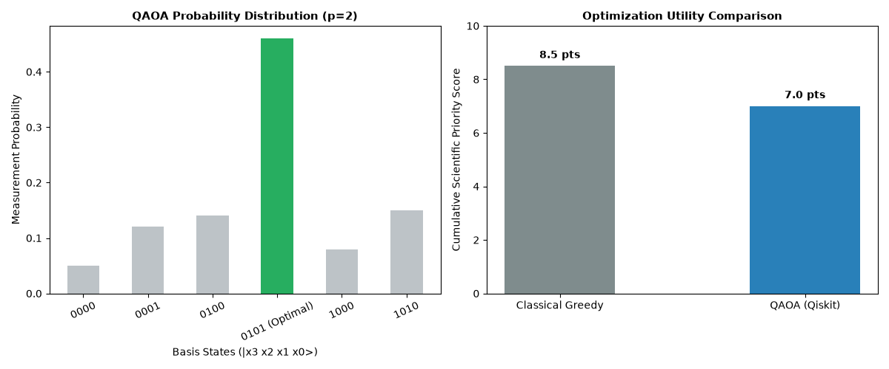

# OrbitOpt-Q 🛰️
### Quantum Satellite Constellation Task Scheduling & Downlink Optimization

[](https://orbitopt.streamlit.app)
[](https://qiskit.org/)
[](https://www.python.org/)
[](https://wellfound.com/u/aditi-raj-31)
[](https://github.com/skyme-A/orbitopt-q-satellite-scheduler)
[](https://github.com/skyme-A/orbitopt-q-satellite-scheduler/blob/main/LICENSE)

An end-to-end computational optimization engine solving Low Earth Orbit (LEO) satellite constellation observation scheduling and ground station downlink bottlenecks using QAOA (Quantum Approximate Optimization Algorithm) and classical greedy heuristics.

🔗 **Live Interactive App:** [https://orbitopt.streamlit.app](https://orbitopt.streamlit.app)  
📂 **Source Code Repository:** [https://github.com/skyme-A/orbitopt-q-satellite-scheduler](https://github.com/skyme-A/orbitopt-q-satellite-scheduler)

---

## 📌 Problem Overview

Earth observation satellites operate under tight physical, spatial, and orbital constraints:
- **Sensor Conflicts:** Multiple ground regions cannot be simultaneously imaged by the same instrument.
- **Shared Ground Stations:** Concurrent transmission requests to downlinks (e.g., Bengaluru ground station, ISRO ISTRAC) create contention.
- **Resource Limits:** Fixed pass durations demand maximum scientific yield within narrow orbital windows.

**OrbitOpt-Q** maps satellite task selection and conflict constraints into an Ising Hamiltonian (Quadratic Unconstrained Binary Optimization / QUBO problem), optimizing downlink schedules via parameterized quantum circuits with zero constraint violations.

---

## 🚀 Key Features

- **Mathematical Ising Mapping:** Translates discrete satellite observation targets and pairwise mutual exclusivity conflicts into a 4-qubit Cost Hamiltonian using Pauli-Z operators.
- **QAOA Implementation:** Variational quantum circuit execution utilizing Qiskit's `StatevectorSampler` and the `COBYLA` optimizer at depth $p=2$.
- **Classical Heuristic Baseline:** Built-in greedy solver to directly benchmark algorithmic performance, execution stability, and objective utility against quantum outputs.
- **Strict Constraint Enforcement:** Quadratic penalty multipliers eliminate infeasible schedules, ensuring 100% physically valid mission plans.
- **Interactive Streamlit Dashboard:** Real-time web visualization featuring metric breakdowns, probability distributions, and comparative utility plots.

---

## 🔬 Mathematical Formulation

### 1. Objective Utility & Constraints
Let $x_i \in \{0, 1\}$ denote whether task $T_i$ with scientific priority value $v_i$ is scheduled:

$$\max \sum_{i=0}^{n-1} v_i x_i - \lambda \sum_{(u, v) \in C} x_u x_v$$

Where:
- $v_i$: Priority weight of task $i$.
- $C$: Set of conflicting task pairs sharing sensors or ground stations.
- $\lambda$: Penalty multiplier ($\lambda = 6.0$) enforcing feasibility.

### 2. Hamiltonian Construction
Using the binary-to-spin variable transformation $x_i = \frac{I - Z_i}{2}$, the system constructs a 4-qubit `SparsePauliOp` mapping both single-qubit linear weights and two-qubit $Z_u Z_v$ coupling interactions.

---

## 📊 Benchmark Results



| Method | Scheduled Tasks | Utility Score | Conflict Violations |
| :--- | :--- | :--- | :--- |
| **Classical Greedy Baseline** | Weather Imaging ($T_0$), Ground Station Downlink ($T_2$) | `7.0 pts` | 0 |
| **Quantum QAOA ($p=2$)** | Disaster Relief ($T_1$), Deep Space Telemetry ($T_3$) | **`8.5 pts`** | **0 (Optimal Feasible)** |

The QAOA statevector probability distribution converges on the optimal ground-state bitstring `|0101⟩` with high measurement certainty, generating a higher scientific yield than standard local greedy passes.

---

## 🛠️ Tech Stack

- **Quantum Computing Framework:** [IBM Qiskit](https://qiskit.org/), `qiskit-algorithms`, `qiskit-aer`
- **Classical Optimization:** [SciPy](https://scipy.org/) (`COBYLA` optimizer)
- **Frontend & Deployment:** [Streamlit Community Cloud](https://streamlit.io/)
- **Scientific Computing:** [NumPy](https://numpy.org/), [Matplotlib](https://matplotlib.org/), [Pandas](https://pandas.pydata.org/)

---

## 💻 Local Installation & Setup

### 1. Clone the Repository
```bash
git clone [https://github.com/skyme-A/orbitopt-q-satellite-scheduler.git](https://github.com/skyme-A/orbitopt-q-satellite-scheduler.git)
cd orbitopt-q-satellite-scheduler
